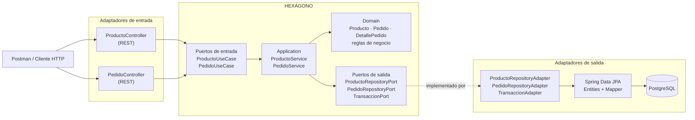

<!-- by from ia -->
# Arquitectura Hexagonal (Ports and Adapters) - Tienda API

Refactorización del proyecto del segundo corte (gestión de **productos y pedidos**) de una arquitectura por capas
a **Arquitectura Hexagonal**. Los endpoints, el JSON y las tablas **no cambian**: la API se comporta igual,
pero la lógica de negocio ya no depende de Spring, JPA ni PostgreSQL.

## 1. Cómo estaba organizado antes

```
controller  ->  service  ->  repository (JpaRepository)  ->  PostgreSQL
                   \______ model = @Entity + Jackson ______/
```

Problemas:
- `Pedido`, `Producto` y `DetallePedido` eran a la vez entidad de negocio, entidad JPA y respuesta JSON
  (`@Entity`, `@JsonManagedReference`, `@JsonBackReference`).
- `PedidoService` dependía de `PedidoRepository extends JpaRepository`, de `ProductoService` y de `@Transactional` de Spring.
- Las reglas (estado `CARRITO`, cálculo de totales, stock) estaban en el servicio, con entidades anémicas.
- El servicio no se podía probar sin Mockito sobre clases de Spring Data.

## 2. Estructura nueva

```
src/main/java/com/tienda/api/
├── domain/                              <- NÚCLEO (Java puro, sin frameworks)
│   ├── model/        Producto, Pedido, DetallePedido, EstadoPedido
│   ├── exception/    RecursoNoEncontradoException, ReglaNegocioException, ConflictoException
│   └── port/
│       ├── in/       ProductoUseCase, PedidoUseCase                     (puertos de ENTRADA)
│       └── out/      ProductoRepositoryPort, PedidoRepositoryPort,
│                     TransaccionPort                                    (puertos de SALIDA)
├── application/
│   └── service/      ProductoService, PedidoService                     (casos de uso)
├── infrastructure/
│   ├── adapter/
│   │   ├── input/rest/   ProductoController, PedidoController, ManejadorGlobalExcepciones
│   │   │   └── dto/      ProductoRequest/Response, PedidoRequest/Response, ItemRequest
│   │   └── output/persistence/
│   │       ├── ProductoRepositoryAdapter, PedidoRepositoryAdapter, TransaccionAdapter
│   │       ├── entity/       ProductoEntity, PedidoEntity, DetallePedidoEntity  (@Entity)
│   │       ├── repository/   ProductoJpaRepository, PedidoJpaRepository
│   │       └── mapper/       PersistenciaMapper (dominio <-> entidad JPA)
│   └── config/       BeanConfig  (ensambla casos de uso + adaptadores)
└── ApiApplication.java
```

Regla de dependencias: `infrastructure -> application -> domain`. Nada del dominio ni de `application`
importa `org.springframework`, `jakarta.persistence`, Jackson ni Lombok.

## 3. Diagrama



Versión en texto:

```
 Cliente HTTP
      |
 [ProductoController / PedidoController]   <- adaptador de ENTRADA (REST)
      |  llama a
 [ProductoUseCase / PedidoUseCase]         <- puerto de ENTRADA (interfaz)
      |  implementado por
 [ProductoService / PedidoService]         <- application (casos de uso)
      |  usa
 [Producto / Pedido / DetallePedido]       <- domain (reglas de negocio)
      |  se persiste mediante
 [ProductoRepositoryPort / PedidoRepositoryPort / TransaccionPort]  <- puerto de SALIDA
      |  implementado por
 [ProductoRepositoryAdapter / PedidoRepositoryAdapter / TransaccionAdapter]  <- adaptador de SALIDA
      |
 [Spring Data JPA + Entities + Mapper]  ->  PostgreSQL
```

## 4. Puertos y adaptadores

| Tipo | Puerto (interfaz en el dominio) | Adaptador (en infraestructura) |
| :--- | :--- | :--- |
| Entrada | `ProductoUseCase` | `ProductoController` (REST `/api/productos`) |
| Entrada | `PedidoUseCase` | `PedidoController` (REST `/api/pedidos`) |
| Salida | `ProductoRepositoryPort` | `ProductoRepositoryAdapter` -> `ProductoJpaRepository` |
| Salida | `PedidoRepositoryPort` | `PedidoRepositoryAdapter` -> `PedidoJpaRepository` |
| Salida | `TransaccionPort` | `TransaccionAdapter` (`TransactionTemplate` de Spring) |

## 5. Dónde quedó cada funcionalidad

| Funcionalidad | Caso de uso | Regla de negocio en el dominio |
| :--- | :--- | :--- |
| Crear / consultar / actualizar / eliminar producto | `ProductoService` | `Producto.descontarStock`, `actualizarDatos` |
| Crear pedido | `PedidoService.crear` | `Pedido.nuevo` (cliente obligatorio), `DetallePedido.crear` (cantidad > 0, subtotal) |
| Consultar pedidos | `listarTodos`, `buscarPorId` | - |
| Actualizar pedido | `PedidoService.actualizar` | `Pedido.reemplazar` (solo en `CARRITO`) |
| Agregar / quitar ítem | `agregarItem`, `quitarItem` | `Pedido.agregarItem/quitarItem` + `recalcularTotal` |
| Confirmar pedido | `PedidoService.confirmar` (transaccional) | `Pedido.confirmar` (carrito no vacío, stock suficiente) |
| Eliminar pedido | `PedidoService.eliminar` | - |
| 409 al borrar producto usado | `ProductoRepositoryAdapter` traduce `DataIntegrityViolationException` | `ConflictoException` |

## 6. Cómo se comunica el dominio con la infraestructura

1. El controlador recibe HTTP, convierte el DTO a un *command* (`PedidoCommand`) y llama al puerto de entrada.
2. El caso de uso carga datos mediante **puertos de salida** (interfaces definidas en el dominio).
3. La lógica corre en el modelo de dominio (`Pedido.confirmar(...)`).
4. El caso de uso guarda con el puerto; el **adaptador** convierte dominio -> `Entity` con `PersistenciaMapper` y usa JPA.
5. El resultado vuelve como objeto de dominio y el controlador lo transforma en `PedidoResponse`.
6. Las excepciones del dominio (`ReglaNegocioException`, `RecursoNoEncontradoException`, `ConflictoException`) se
   traducen a 400 / 404 / 409 en `ManejadorGlobalExcepciones`.

La transacción de `confirmar` (descontar stock de todos los productos o ninguno) se logra con `TransaccionPort`,
así la capa `application` no necesita `@Transactional` de Spring.

## 7. Ventajas frente a la estructura anterior

- **Dominio independiente**: reglas probadas con Java puro (`PedidoDominioTest`), sin Spring ni base de datos.
- **Casos de uso probados con adaptadores en memoria** (`CasosDeUsoTest`): demuestra que la lógica no depende de PostgreSQL.
- **Bajo acoplamiento**: cambiar PostgreSQL por otro motor, o REST por gRPC/CLI, solo implica escribir otro adaptador.
- **Separación de responsabilidades**: el JSON (DTO), la tabla (Entity) y el negocio (Domain) evolucionan por separado.
- **Reglas con dueño claro**: el estado `CARRITO`, los totales y el stock viven en `Pedido`/`Producto`, no repartidos en servicios.

## 8. Pruebas

```bash
./mvnw test -Dtest='PedidoDominioTest,CasosDeUsoTest'   # no requieren base de datos
./mvnw test                                              # incluye contextLoads: requiere PostgreSQL (docker compose up -d)
```

Los endpoints no cambiaron: la colección `TiendaYa_API.postman_collection.json` sigue siendo válida
para demostrar el funcionamiento (25 casos: Productos y Pedidos).
